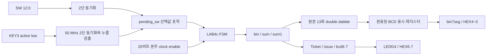
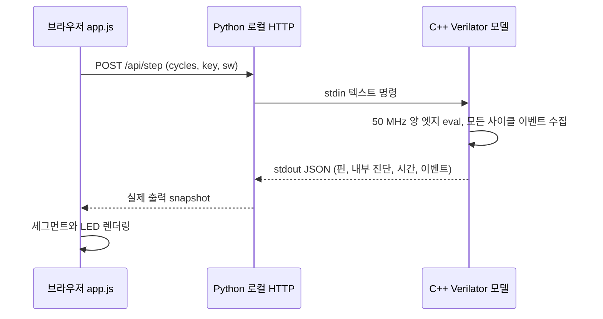

# 설계와 연결

## 자료와 원본

ZIP은 단일 `TINYPROJECT.v`에 TINYPROJECT, LAB4c, bin7seg 세 모듈을 포함한다. `.qpf`, `.qsf`, 백업 `.v.bak/.qsf.bak`, 워크스페이스 `.qws`, 기존 map/fit/sta/flow 보고서가 있다. SDC, 테스트벤치, include, ROM 초기값, 외부 IP는 없다. QSF의 top은 TINYPROJECT, FPGA는 EP4CE115F29C7, 유일한 Verilog 파일은 TINYPROJECT.v이다. 전체 ZIP 추출물은 `legacy/private/archive/`에 로컬 보존한다.

원본은 CLOCK_50의 posedge에서 blocking 대입으로 20비트 Clk_Down을 올리고 bit19를 별도 Clk로 사용한다. 처음 상승은 524288번째 50 MHz 클록, 이후 주기는 1048576클록(약 47.6837 Hz)이다. 분주기만 선언 초기값 0을 갖고 reset이 없다. KEY0을 반전한 비동기 active-high rst_가 datapath와 FSM에 연결된다. 원본 Ticket은 reset에서 초기화되지 않는다. 사용되지 않는 암시적 tic은 떠 있으며 새 RTL에서는 제거했다.

## 수정 구조

실제 순차 클록은 모두 CLOCK_50 하나이며 분주값을 clock enable로 사용한다. 기본 DIV_BITS=20은 원래 FSM 실행 간격을 유지한다. reset 시 분주기 위상도 0으로 만든다. UI 데모만 DIV_BITS=2로 빌드하며 원래 타이밍의 별도 모델과 시험이 있다. reset 해제는 비동기 입력의 직접 해제이며 물리적 recovery/removal 검증을 수행하지 않았다.

원본의 bin 입력 해석·sum 잔액·sum1 이동·BCD add3/shift 알고리즘을 유지했다. sum=14비트, bin/sum1=13비트이며 0~8000을 담는다. 가산은 14비트로 비교 후 8000으로 포화하여 13000까지의 중간합도 overflow하지 않는다. 첫 수정에서는 원본 코드의 작은 기능 패치만 적용했고, 이후 별도 커밋에서 클록과 입력 포착을 변경하고 모듈 파일을 분리했다. 수정 전 전체 재작성으로 시작하지 않았다.

| FSM 상태 | 출력/동작 | 전이 |
|---|---|---|
| S0 | loadbin, 첫 입력 대기 | 저장된 IN 있으면 S1 |
| S1 | hap, 입금 또는 충분한 잔액의 티켓 차감·수량 증가 | S2 |
| S2 | happ, sum을 sum1에 복사 | S3 |
| S3 | shift, BCD로 1비트 이동, count 증가 | S4 |
| S4 | count!=13이면 BCD add3 | count=13이면 S5, 아니면 S3 |
| S5 | done, count=0, 완성 BCD 표시, loadbin | Ticket=1 우선 S6; 그 외 IN이면 S1 |
| S6 | prt, 표시 완료값 유지 | S7 |
| S7 | loadbin, 다음 입력 대기 | IN이면 S1, 아니면 S7 |

3비트의 8개 수치 상태가 모두 사용되므로 남는 숫자 상태는 없다. X 상태에서 조합 default가 S0를 선택하는 것은 Icarus 단위 테스트로 확인한다. Verilator의 2상태 실행만으로 X 복구를 판정하지 않는다.

Ticket은 발권 표시용 래치이며 다음 동기화된 SW 변경에서 0으로 지운다. 같은 종류의 티켓을 연속 구매해도 issue는 매번 CLOCK_50 한 주기로 발생한다. UI는 issue와 LED·잔액 변경을 모든 시뮬레이션 클록에서 수집한다. 화면 갱신 주기와 별개다. 수량 bcd6/7은 원본 4비트로 유지: 10~15는 decoder default 패턴, 16에서 0. 사용자가 이 제한 보존을 명시했다.

## 보드 I/O 확인

[Terasic 공식 매뉴얼](https://www.terasic.com.tw/attachment/archive/502/DE2_115_User_manual.pdf) §4.2~4.5(인쇄 32~38쪽)와 원본 QSF를 대조했다. 매뉴얼 PDF는 다운로드 후 HEX 그림도 시각 확인했다. 매뉴얼 자체는 Git 재배포하지 않는다.

| 신호 | 역할 / 극성 | QSF 핀과 근거 |
|---|---|---|
| CLOCK_50 | 50 MHz | Y2, 매뉴얼 표4-5 |
| KEY0 | 누름=0, reset | M23, §4.2 |
| KEY3 | 누름=0, In; 보드 Schmitt debounce | R24, §4.2 |
| KEY1/2 | 과제 미사용 | M21/N21 |
| SW0/1/2 | UP=1, DOWN=0; 500/1000/5000 | AB28/AC28/AC27 |
| SW6/7 | 3300/6600 티켓 선택 | AD26/AB26 |
| SW3~5,8~12 | 지정되지 않은 입력 | 원본 포트 범위 보존 |
| LEDG4 | 1=점등, Ticket | H21, §4.3 |
| HEX0~4 | 잔액 하위→상위 자리 | 원본은 HEX4 포트 누락; QSF 핀 AB19,AA19,AG21,AH21,AE19,AF19,AE18은 확보 |
| HEX6/7 | 티켓6/7 수량 | QSF와 매뉴얼 표4-4 |
| LEDG 나머지/LEDR | 0 고정 | 원본 미구동을 정의된 출력으로 변경 |
| HEX5 | 미연결 | UI도 임의 숫자 대신 미연결로 표시 |

HEX 포트는 원본의 `[0:6]` 오름차순을 유지한다. 0=상단(a), 1=오른쪽 위(b), 2=오른쪽 아래(c), 3=하단(d), 4=왼쪽 아래(e), 5=왼쪽 위(f), 6=중앙(g), 0이 점등이다. C++ 정수로 변환 시 포트 인덱스0은 정수의 bit6이다. UI는 `6-segmentIndex` 비트를 읽으며 숫자를 계산해 그리지 않는다. ASCRANGE 경고만 해당 선언 주위에서 이유를 갖고 좁게 해제했다. 다른 lint 경고는 전체 무시하지 않았다.

## 시뮬레이터와 UI

`sim/legacy.f`와 `sim/rtl.f`를 구분하여 같은 모듈 이름을 중복 컴파일하지 않는다. 테스트는 iverilog -s로 top을 명시한다. `sim/board_model.sv`는 수정 RTL을 인스턴스하고 실제 내부 state, sum, 카운트, issue를 진단 포트로 노출한다.

Python은 금액이나 FSM을 계산하지 않는다. 연결 실패는 503/오류 표시로 전파한다. 모델 소스·빌드 스크립트·Verilator 버전 SHA-256을 버전에 포함하며 소스 변경 시 재빌드한다. UI 기록 저장은 서버가 실제 수락한 입력 명령 전체와 RTL 버전을 담고, 재생은 기록의 초기 reset을 포함한다. 사이클 카운터는 reset 후에도 시뮬레이션 절대 시간으로 증가한다.

서버는 localhost 한 개 모델을 직렬화해 제어한다. 여러 탭은 같은 보드를 공유한다. 이벤트는 한 요청당 10000개 제한이며 초과 여부를 명시한다. 브라우저 화면 로그는 최근 2000줄, 전체 요청/응답은 `build/session.jsonl`이다. 보드 미검증과 시뮬레이션 성공은 구분한다.
